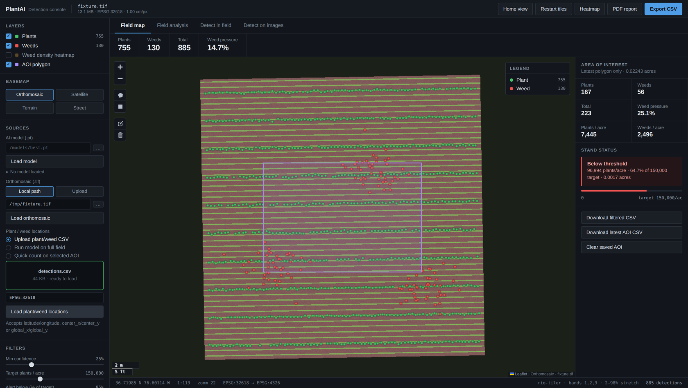
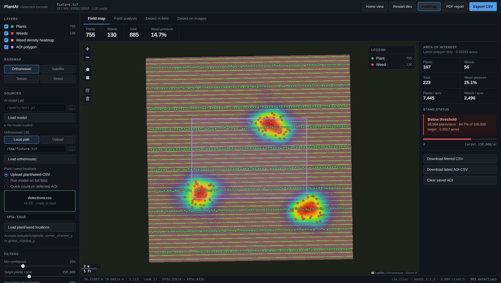
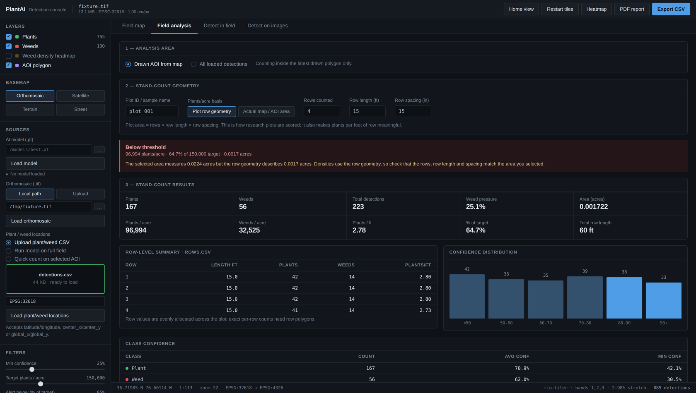
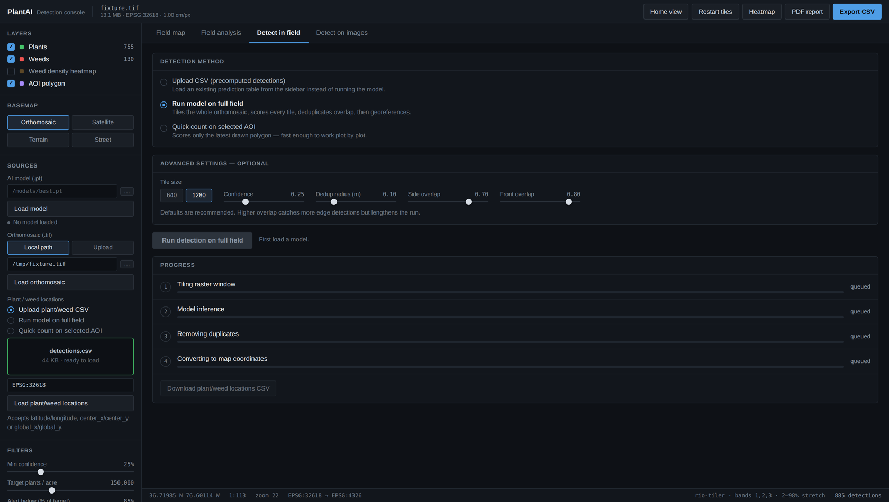

# PlantAI

Plant and weed detection on georeferenced orthomosaics, with the stand-count
analytics that turn detections into an agronomic decision.

Load a UAV orthomosaic, run a YOLO checkpoint over it, then work the results:
review detections on the map, draw a plot, and read plants per acre, plants per
foot of row and weed pressure against a target population.



<details>
<summary>More views</summary>

**Weed density heatmap** — QGIS-style ramp over the weed detections only.



**Field analysis** — stand-count results for the drawn plot, with the row-level
breakdown and confidence distribution.



**Detect in field** — method, parameters and live per-step progress.



</details>

<sub>Screenshots use a synthetic 1 cm/px test mosaic; the detections are the
sample CSV from `tests/`.</sub>

---

## What it does

| | |
|---|---|
| **Orthomosaic map** | The GeoTIFF is served as web-mercator tiles, so a multi-gigabyte mosaic pans and zooms without being converted first. Satellite, terrain and street basemaps are available for working from detections alone. |
| **Tiled detection** | Overlapping windows across the raster (or just a drawn plot), batched through the model, then deduplicated so a plant caught on two tile seams is counted once. Progress streams back live. |
| **Area of interest** | Draw a polygon or rectangle; counts, area and density update for that shape. Only the newest shape counts, so a forgotten polygon can never inflate the next plot. |
| **Stand-count analytics** | Plants/acre and weeds/acre from either the mapped area or the plot's row geometry, plus plants per foot of row, weed pressure, and a status against target. |
| **Exports** | Detections CSV, AOI CSV, `plots.csv`, `rows.csv`, a stand summary, and a one-page PDF report. |
| **Loose images** | Batch inference on JPG/PNG tiles with annotated previews, for spot checks away from the mosaic. |

Detections can also come from a CSV you already have — the model is only needed
to produce new ones.

---

## Quick start

Install [PyTorch](https://pytorch.org) for your machine first, then:

```bash
pip install -r requirements.txt

export MODEL_PATH=/path/to/best.pt     # optional; can be chosen in the UI
export LIBRARY_DIRS=/path/to/models,/path/to/orthos

cd backend
uvicorn main:app --host 127.0.0.1 --port 8000
```

Open <http://127.0.0.1:8000>. The API and the console are served from the same
process, so there is nothing else to start.

### Docker

```bash
mkdir -p models data          # put your .pt in models/, your .tif in data/
docker compose up --build
```

Also <http://127.0.0.1:8000>. `models/` is mounted read-only; `data/` is
read-write so **Build overviews** can rewrite a GeoTIFF in place.

---

## Using it

1. **Load an orthomosaic.** Either a path on the server (fastest — the file is
   read in place) or an upload. The console warns when a large mosaic has no
   overview pyramid and offers to build one; without overviews every map tile
   reads full-resolution pixels, which is what makes a big file feel frozen.
2. **Get detections.** Upload a CSV, run the model over the whole field, or
   draw a plot and run a quick count on just that window.
3. **Draw an area of interest.** The counts, density and stand status follow
   the polygon.
4. **Set the stand-count basis.** *Actual map / AOI area* divides by the
   acreage you selected. *Plot row geometry* derives the area from rows × row
   length × row spacing — the way research plots are scored, and what makes
   plants per foot meaningful. The console warns when the geometry you entered
   and the area you selected disagree by more than 3×.
5. **Export.** Everything on screen has a CSV behind it, plus a PDF report.

### Detection CSVs

Any of these coordinate conventions is accepted:

| Columns | Meaning |
|---|---|
| `latitude`, `longitude` | Already WGS84 |
| `center_x`, `center_y` | Projected; CRS from the sidebar, or a `crs` column |
| `global_x`, `global_y` | Same |

`class` and `confidence` are optional. Confidence stored as percentages is
detected and rescaled, and every assumption the importer makes is reported back
rather than applied silently.

---

## Configuration

Set through the environment; see [`.env.example`](.env.example) for the full
list with defaults.

| Variable | Default | Notes |
|---|---|---|
| `MODEL_PATH` | *(unset)* | Ultralytics-compatible `.pt`. Optional — CSV workflows work without it. |
| `PLANT_CLASSES` | `plant,crop,soybean,faba,fababean` | Checkpoint labels counted as crop. |
| `WEED_CLASSES` | `weed,palmer,ragweed,grass` | Labels counted as weeds. Anything unlisted is treated as a weed. |
| `LIBRARY_DIRS` | `/models,/data` | The only directories the file browser may list. |
| `ALLOW_LOCAL_PATHS` | `1` | Set `0` to force every raster through the upload endpoint. |
| `TILE_SIZE` | `1280` | Inference window, in pixels. |
| `BATCH_TILES` | `4` | Tiles per forward pass. Raise on a GPU, lower if memory is tight. |
| `DEDUP_RADIUS_M` | `0.10` | Detections of the same class closer than this collapse to the strongest. |
| `STAND_TARGET` | `150000` | Target plants/acre. |
| `STAND_ALERT_PCT` | `85` | Below this share of target, the stand reads red. |

---

## How it fits together

```
frontend/                  Static console — no build step, no framework
  index.html               Layout: top bar, dock, tabbed main, status bar
  css/app.css              Design tokens and every rule
  js/
    api.js                 HTTP client and the binary point decoder
    state.js               One store with subscribe/notify
    map.js                 Leaflet, AOI drawing, canvas detection + heat layers
    panels/                One module per tab, plus the sidebar
  vendor/                  Leaflet and Leaflet.draw, vendored for offline use

backend/
  main.py                  App wiring; serves the console too
  plantai/
    api.py                 Every route
    config.py              Environment settings, read once
    raster.py              GeoTIFF description, overviews, tile planning
    tiles.py               XYZ tiles via rio-tiler, one reader per thread
    model.py               Checkpoint loading and label semantics
    detect.py              Tiled inference and spatial deduplication
    jobs.py                Background runs with server-sent progress
    geometry.py            CRS transforms, AOI parsing, point-in-polygon
    analytics.py           Stand metrics, row tables, confidence bands
    csvio.py               Detection CSV import
    report.py              PDF report
    store.py               Session registry and the binary point encoder
```

Three decisions are worth knowing about, because they are what let the console
stay responsive on a real field:

**Detections are not markers.** A field run returns hundreds of thousands of
points. As DOM nodes that locks the browser up, so they are drawn onto a
viewport-culled canvas instead, from typed arrays.

**Points travel as binary.** `GET /api/detections/{id}/points` returns
coordinates as float32 offsets from a float64 reference — about 13 bytes per
detection instead of 60, decoding straight into typed arrays with under a
millimetre of error. The confidence slider then filters client-side, so it
responds instantly rather than round-tripping.

**Tile readers are per thread.** GDAL dataset handles are not thread-safe and
the browser opens six connections at once; a shared handle returns torn blocks
rather than an honest error. Each worker thread keeps its own.

---

## API

Interactive docs at `/docs` once the service is running.

| | |
|---|---|
| `GET /api/health` · `GET /api/config` | Service state and defaults |
| `GET`/`POST /api/model` · `GET /api/library` | Checkpoint status, loading, file browser |
| `POST /api/datasets/upload` · `POST /api/datasets/path` | Register an orthomosaic |
| `POST /api/datasets/{id}/overviews` | Build the pyramid in place |
| `GET /api/datasets/{id}/tiles/{z}/{x}/{y}.png` | XYZ map tiles |
| `POST /api/detections/csv` | Import a detection table |
| `GET /api/detections/{id}/points` | Binary point payload |
| `POST /api/detections/{id}/aoi` | Counts and density inside a polygon |
| `POST /api/detections/{id}/analysis` | Stand metrics, rows, confidence bands |
| `POST /api/detections/{id}/exports/{stand\|plots\|rows}` | CSV exports |
| `POST /api/detections/{id}/report.pdf` | PDF report |
| `POST /api/detect` · `GET /api/jobs/{id}/events` | Start a run, follow its progress |
| `POST /api/images/detect` | Batch inference on loose images |

---

## Tests

```bash
python -m pytest
```

Covers the HTTP surface end to end against a synthetic georeferenced raster,
plus the geometry, deduplication, stand-count and CSV-import logic — including
regressions for tile-reader concurrency and for AOI counting using only the
newest polygon.

---

## Related

[PlantCountGUI](https://github.com/ruuls/PlantCountGUI) — the earlier
FastAPI + Streamlit tool this console's structure grew out of.
